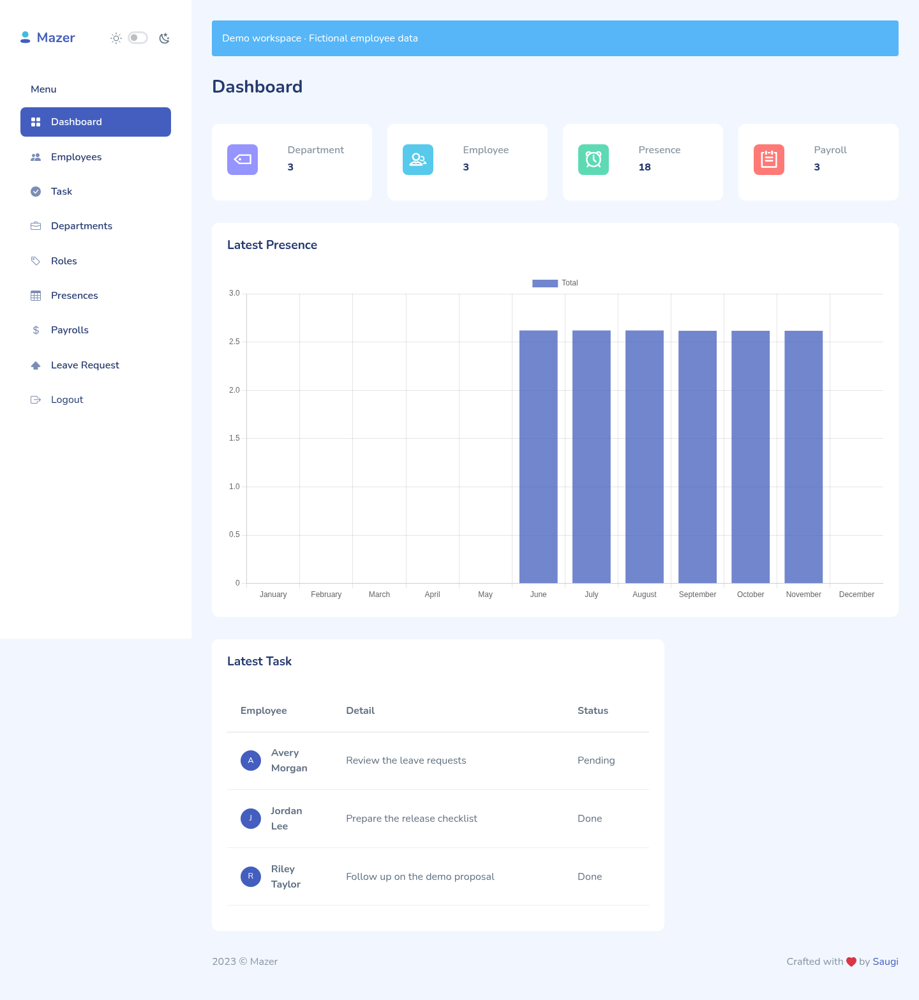
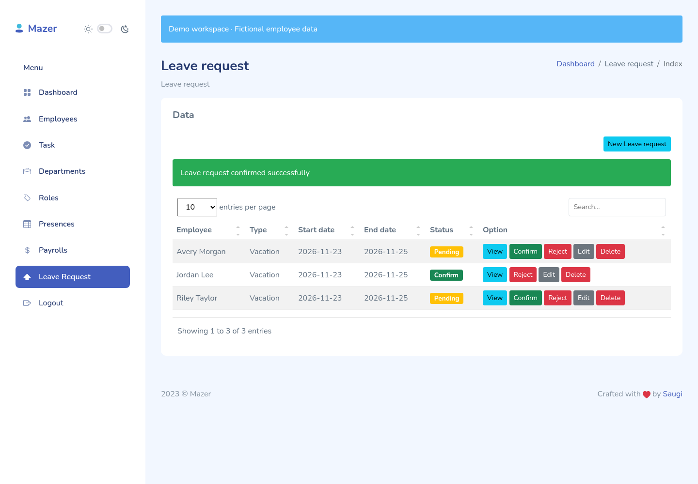
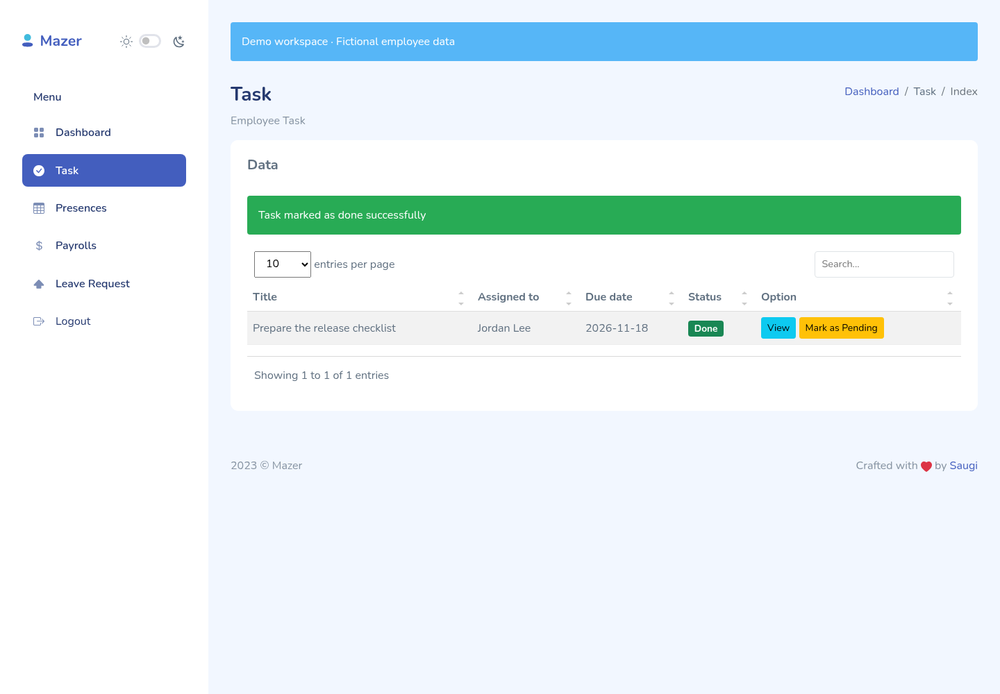

# HRIS

A Laravel human resources application for employee records, attendance, payroll, leave requests, and task assignments. HR manages the workspace; employees use their own task, leave, attendance, and payroll pages.

Built with Laravel 12, PHP 8.2+, Blade, SQLite/MySQL, Vite, Tailwind CSS, and the Mazer dashboard template.

## Try the demo

With Docker and Docker Compose installed:

```bash
git clone https://github.com/MirzaAlbab/hris.git
cd hris
docker compose -f compose.demo.yaml up --build
```

Open [http://localhost:8000](http://localhost:8000). The demo creates a separate SQLite database with fictional employees, tasks, attendance, leave requests, and payroll records. No external database service is needed.

| Role | Email | Password |
| --- | --- | --- |
| HR | `hr@hris.example` | `demo-password` |
| Developer | `developer@hris.example` | `demo-password` |
| Sales | `sales@hris.example` | `demo-password` |

The demo binds to localhost. These accounts are for local evaluation; the seeder refuses to run outside local/testing environments. This development server is not a production deployment configuration. See [the walkthrough](docs/DEMO.md) for workflows, setup without Docker, and reset instructions.

## Screenshots

Screenshots use fictional demo data.

### HR dashboard



### Leave management



### Employee tasks



## Features and permissions

| Capability | HR | Developer / Sales |
| --- | --- | --- |
| Manage employees, departments, and roles | Yes | No |
| Create, assign, edit, or delete tasks | Yes | No |
| View tasks and mark them done/pending | All tasks | Assigned tasks |
| Submit leave requests | For an employee | For self |
| View leave, attendance, and payroll records | All records | Own records |
| Approve/reject leave or edit/delete leave records | Yes | No |
| Record attendance | For an employee | Self check-in |
| Manage payroll and edit/delete attendance | Yes | No |

Checks run on the server. Missing employee/role assignments return 403 rather than a server error. Leave decisions and task status changes use CSRF-protected PATCH forms; opening their URLs with GET does not change records.

## Local development

Install PHP compatible with `composer.lock`, Composer, Node.js, and npm. The Docker demo uses PHP 8.4 and Node.js 22.

```bash
composer install
cp .env.example .env
php artisan key:generate
```

Configure `DB_*` in `.env`. For SQLite, create the database file and set `DB_DATABASE` to its absolute path. Then:

```bash
php artisan migrate
npm ci
npm run build
php artisan serve
```

For frontend development, run `npm run dev` in another terminal. For linked demo accounts, follow [docs/DEMO.md](docs/DEMO.md) instead of the older random-data seeder. Self-registration does not assign an employee or HR role.

## Tests

```bash
npm run build
php artisan test
```

The PHP suite includes authentication, role restrictions, ownership, task transitions, leave decisions, CSRF, and demo-seeder behavior. It uses an in-memory SQLite database through `phpunit.xml`.

With a demo running at port 8000:

```bash
npm ci
npx playwright install chromium
npm run test:browser
```

Browser checks cover HR leave decisions, employee task updates, management-route denial, and logout. Set `DEMO_URL` to test another local demo address. See the walkthrough for screenshot capture.

GitHub Actions builds the frontend, runs PHP tests, starts a seeded demo, and runs browser checks on pull requests and pushes to `main`.

## Project structure

- `app/Http/Controllers/` — request handling and record-access checks
- `app/Http/Middleware/CheckRoles.php` — employee-role authorization
- `app/Providers/AppServiceProvider.php` — employee-record access gate
- `database/migrations/` — database schema
- `database/seeders/DemoSeeder.php` — local demo accounts and sample records
- `resources/views/` — Blade pages and forms
- `tests/Feature/` — PHP feature and permission tests
- `tests/browser/` — Playwright demo checks

## Credits and license

Built with [Laravel](https://laravel.com/docs) and [Mazer](https://github.com/zuramai/mazer). Their packages and assets retain their respective licenses. No root project `LICENSE` file is included; contact the repository owner about reuse of application code.
